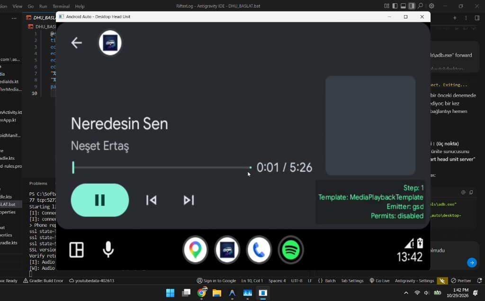
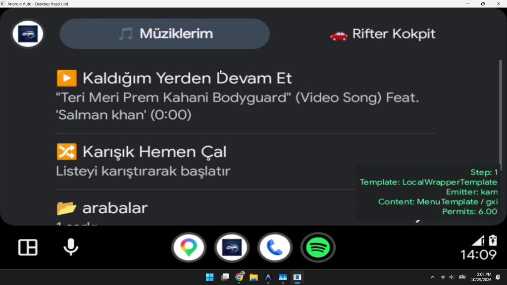
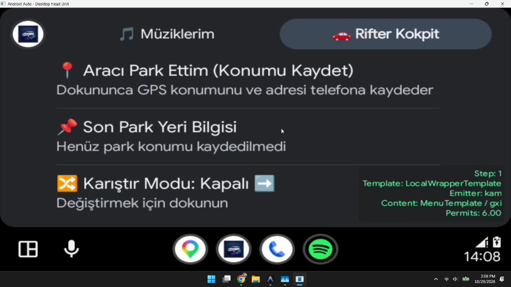
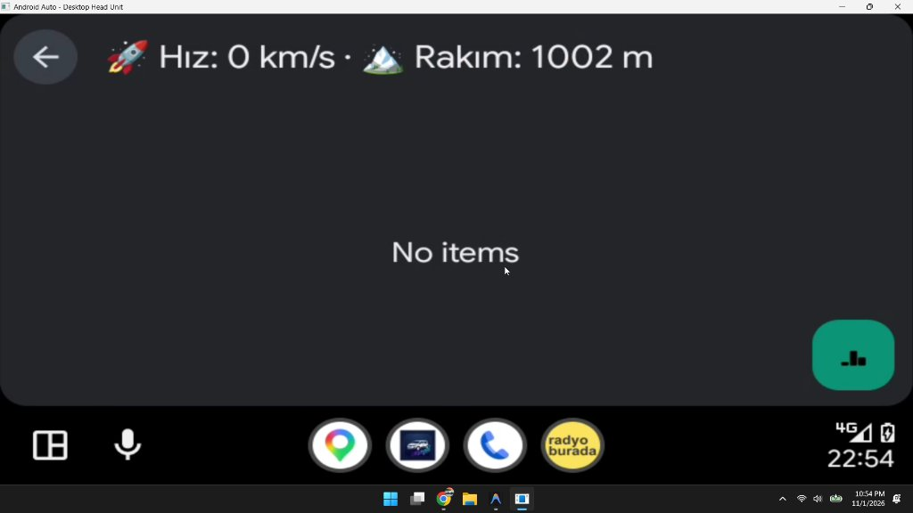
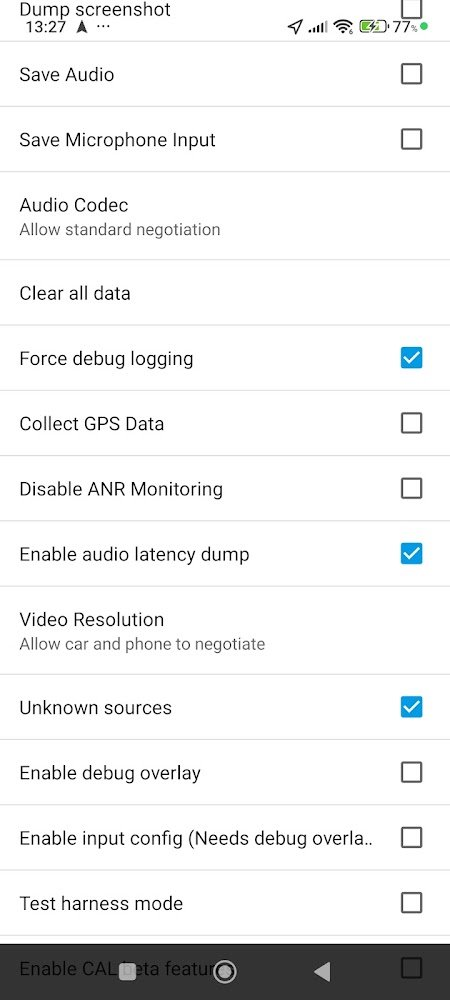

# 🚗 CarCockpit-Auto

<div align="center">


<p align="center">
  <b>Tüm Android Auto uyumlu araçlar için açık kaynaklı araç içi kokpit, canlı GPS hız/rakım, akıllı hava durumu, otopark takip asistanı ve çevrimiçi radyo / müzik çalar suite.</b>
</p>

[Özellikler](#-özellikler) • [Ekran Görüntüleri](#-ekran-görüntüleri) • [Android Auto Kurulum Rehberi (Sideload)](#-android-auto-kurulum-rehberi-sideload) • [Teknoloji Yığını](#-teknoloji-yığını) • [İndirme & Derleme](#-indirme-ve-kurulum) • [Geliştirici](#-geliştirici)

</div>

---

## 📌 Genel Bakış

**CarCockpit-Auto**, tüm Android Auto destekli araçlarda (Peugeot, Renault, Fiat, Volkswagen, Toyota, Ford, Hyundai, Opel, Dacia, Skoda, Honda vb.) multimedya ve sürüş deneyimini zenginleştirmek için geliştirilmiş modern bir Android yol arkadaşıdır. 

Sıradan bir müzik çaların ötesinde; **donanımsal GPS hız ve rakım takibi**, **çift motorlu hibrit hava durumu**, **tek tıkla araca götüren akıllı otopark asistanı** ve **kapsamlı online / manuel radyo motorunu** Android Auto araç ekranı (DHU / Araç Multimedya Ünitesi) ile telefonunuz arasında senkronize eder.

---

## ✨ Özellikler

### 🚗 1. Android Auto Derin Entegrasyonu (`MediaBrowserServiceCompat`)
- Araç multimedya ekranından doğrudan erişilebilen çalma listeleri, yerel müzikler ve online canlı radyolar.
- Araç ekranının üst bilgi çubuğunda anlık **Hız**, **Rakım** ve **Hava Durumu** göstergeleri.
- Sürüş güvenliği standartlarına (DHU) uygun, sürücüyü yormayan ve dikkat dağıtmayan tek dokunuşlu geri dönüş yapısı (`No items` tek seviye backstack mimarisi).

### 🚀 2. Canlı Araç Kokpiti (Hız & Rakım)
- Telefonun donanımsal GPS yongasından internete ihtiyaç duymadan sıfır gecikmeyle okunan **Hız (km/s)**.
- Deniz seviyesinden anlık **Rakım (metre)** ölçümü.

### 🌤️ 3. Akıllı Çift Motorlu Hibrit Hava Durumu
- **1. Motor (Birincil):** Mobil operatörlerin ortak IP (CGNAT) kotalarına takılmayan, ultra hızlı `wttr.in` entegrasyonu.
- **2. Motor (Yedek):** `Open-Meteo` REST API servisi.
- **Akıllı Çevrimdışı Önbellek (Offline Cache):** Tünel, kapalı otopark veya internetin çekmediği güzergahlarda ekranda *"bekleniyor"* uyarısı yerine son bilinen sıcaklık ve hava durumunu korur.
- Telefon veya araç ekranından tek dokunuşla anında senkronize yenileme.

### 🅿️ 4. Akıllı Otopark Takipçisi & Yürüyerek Araca Götür
- **Tek Tıkla Konum Kaydetme:** Arabanızı park ettiğiniz anda GPS koordinatlarını ve ters coğrafi kodlama (Reverse Geocoding) ile açık adresi otomatik kaydeder.
- **Arabama Götür (Yürüyüş Navigasyonu):** Google Haritalar üzerinden arabanızın tam yanına yaya olarak rota çizer.
- **Park Geçmişi & Notlar:** Eski park konumları, tarih/saat, özel notlar ve park yeri fotoğrafları.
- **Kopyalanabilir Detaylar:** Koordinatlar ve tam adres tek dokunuşla panoya kopyalanabilir.

### 📻 5. Kapsamlı Online & Manuel Radyo Motoru
- **Yerleşik İstasyonlar:** Türkiye ulusal/bölgesel FM radyoları ve kategori seçkileri.
- **Online İstasyon Arama:** Radio-Browser API üzerinden binlerce yerli/yabancı radyo arama motoru.
- **Akıllı Format & Bozuk Link Filtreleme:** Sadece ses akışları taranır; web sayfaları (`.html`, `.php`) veya oynatılamayan çalma listesi uzantıları (`?pl=m3u`, `?pl=pls`) otomatik temizlenir.
- **Mükerrer İstasyon Koruması:** Önceden listenize eklediğiniz radyolar aramada *"✓ Listenizde Ekli"* olarak işaretlenir, çakışma ve mükerrer kayıt önlenir.
- **Hızlı Manuel Link Ekleme:** `HTTP://` ve `HTTPS://` kısayol butonları ve çift yapıştırma korumasıyla özel radyo akış URL'si ekleme.

### 🎵 6. Yerel Müzik Çalar & Özel Çalma Listeleri
- Telefon hafızasındaki veya SD karttaki ses dosyalarını otomatik indeksleme.
- İsteğe göre özelleştirilebilir çalma listeleri oluşturma.
- Müzikleri alfabetik veya en son eklenme tarihine göre sıralama.
- Arka planda kesintisiz müzik çalma (`Foreground MediaService`).

### 🌓 7. Modern UI / UX & Tema
- Google Material 3 (Material You) tasarım dili.
- Otomatik Gece / Gündüz modu desteği.

---

## 📸 Ekran Görüntüleri

| Android Auto Müzik Oynatıcı | Android Auto Müziklerim & Çalma Listeleri |
|:---:|:---:|
|  |  |

| Android Auto Otopark Takibi | Android Auto Kokpit & Hız/Rakım |
|:---:|:---:|
|  |  |

---

## 📲 Android Auto Kurulum Rehberi (Sideload)

> [!IMPORTANT]
> Google'ın güvenlik politikası gereği, Google Play Store dışından (GitHub APK / Doğrudan Kurulum) indirilen uygulamalar araç ekranında varsayılan olarak gizlenir. 
> Uygulamanın araç ekranında görünmesi için telefonunuzda **yalnızca 1 kez** aşağıdaki basit adımları yapmanız yeterlidir:

```
1. Telefonunuzda Ayarlar'a girin.
2. Arama çubuğuna "Android Auto" yazın ve Android Auto ayarlarına girin.
   (Veya: Ayarlar ➔ Bağlı Cihazlar ➔ Bağlantı Tercihleri ➔ Android Auto)
3. Sayfanın en altına kaydırın ve "Sürüm" (Version) yazısına art arda 10 kez dokunun.
4. Ekrana "Geliştirici modu açılsın mı?" uyarısı gelince "Tamam" deyin.
5. Sağ üstteki üç nokta (⋮) menüsüne dokunun ve "Geliştirici ayarları" (Developer settings) seçeneğine girin.
6. "Bilinmeyen kaynaklar" (Unknown sources) seçeneğini işaretleyerek AKTİF hale getirin.
7. Bir önceki menüde yer alan "Başlatıcıyı Özelleştir" (Customize launcher) menüsüne girin ve
   "RifterLog" (CarCockpit) uygulamasının yanındaki kutucuğun İŞARETLİ olduğundan emin olun.
```

<div align="center">
  
</div>

Artık telefonunuzu araca USB kablosuyla veya kablosuz olarak bağladığınızda uygulama araç ekranında görünecek ve kullanıma hazır olacaktır! 🚀

---

## 🛠️ Teknoloji Yığını

- **Dil:** [Kotlin](https://kotlinlang.org/) 2.0+
- **Arayüz:** Jetpack Compose + Material 3 Design
- **Araç Entegrasyonu:** Android Auto `MediaBrowserServiceCompat`, `MediaSessionCompat`
- **Ses & Akış Motoru:** Google AndroidX Media3 ExoPlayer (`HLS`, `Icecast`, `MP3`, `AAC`, `FLAC`)
- **Veritabanı:** Room Database v5 (SQLite)
- **Konum & Sensör:** Android LocationManager (Dahili GPS donanımı), Geocoder
- **Hava Durumu API:** `wttr.in` REST JSON API + `Open-Meteo`
- **Radyo Dizini:** `Radio-Browser API`
- **Asenkron Yapı:** Kotlin Coroutines & StateFlow

---

## 📥 İndirme ve Kurulum

Hazır imzalı Release APK dosyasını [GitHub Releases](https://github.com/ahmetakaslan1/CarCockpit-Auto/releases) sayfasından indirebilirsiniz.

Projeyi yerel ortamınızda kaynak koddan derlemek için:
```bash
# Projeyi klonlayın
git clone https://github.com/ahmetakaslan1/CarCockpit-Auto.git
cd CarCockpit-Auto

# Release APK derleyin
./gradlew assembleRelease
```

Derlenen APK dosyanız şu dizinde hazır olacaktır:
`app/build/outputs/apk/release/app-release.apk`

---

## 👤 Geliştirici

- **Geliştirici:** Ahmet Akaslan
- **GitHub:** [@ahmetakaslan1](https://github.com/ahmetakaslan1)
- **Proje Deposu:** [CarCockpit-Auto](https://github.com/ahmetakaslan1/CarCockpit-Auto)

---

## ⚖️ Yasal Uyarı / Disclaimer

Bu uygulama tamamen bağımsız, hobi ve açık kaynak amaçlı geliştirilmiştir. Otomobil markaları veya Google LLC (Android Auto) ile resmi bir bağı, sponsorluğu veya ortaklığı bulunmamaktadır. Tüm marka ve model isimleri ilgili hak sahiplerinin mülkiyetindedir.

---

## 📄 Lisans

Bu proje [MIT Lisansı](LICENSE) altında lisanslanmıştır. Dilediğiniz gibi kullanabilir, katkıda bulunabilir ve paylaşabilirsiniz.
